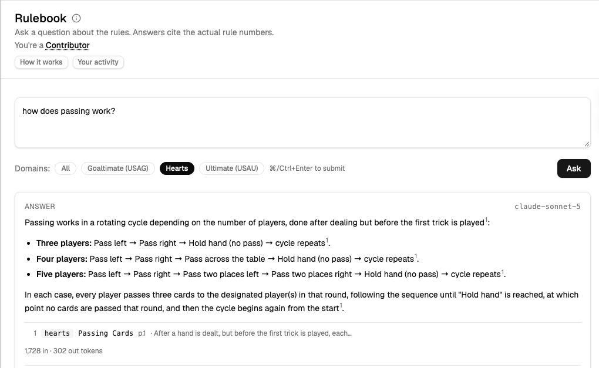
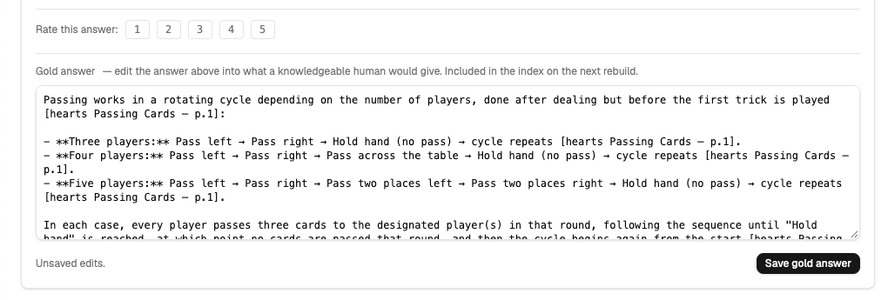
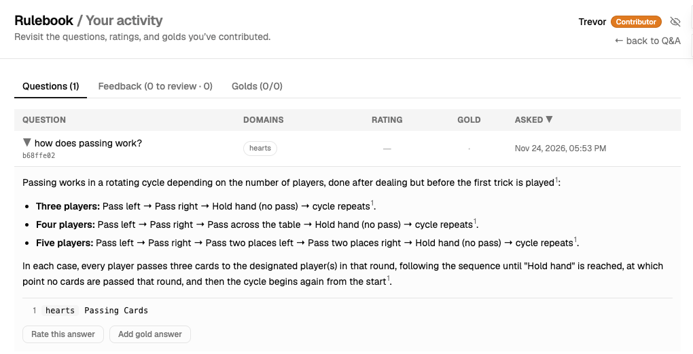
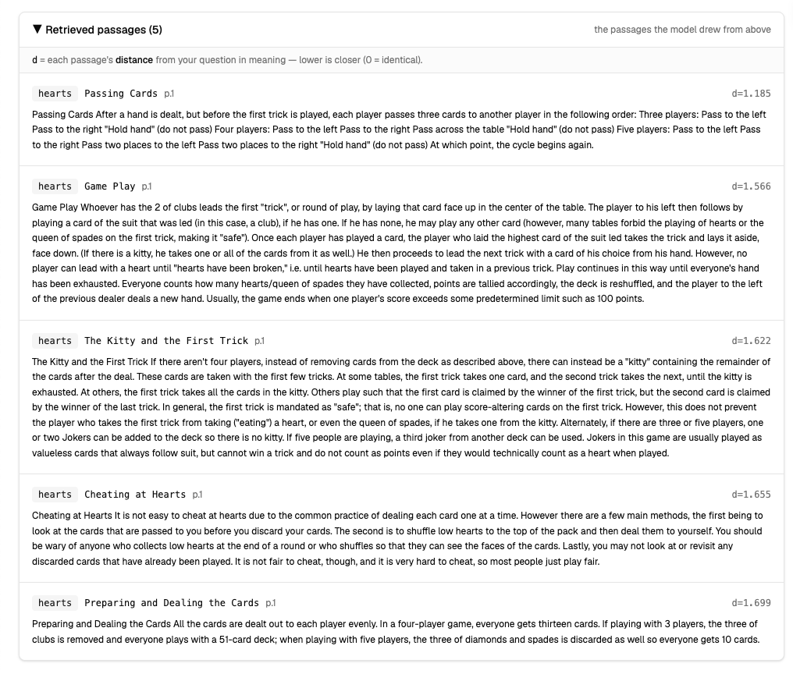

# Rulebook

[](https://github.com/ecoop/rulebook/actions/workflows/ci.yml)


_Last updated: 2026-11-24_

**Rulebook** answers questions about rulebooks. Ask it something, and it answers from the rules themselves: every claim carries a footnote to the rule it comes from, and the passages it read are one click away. It runs at [rulebook.cooper.nu](https://rulebook.cooper.nu) for a weekly goaltimate pickup group, with ultimate, goaltimate, badminton, curling, hearts and backgammon loaded. Access is by invitation.



<sub>An answer about hearts with its footnote. Hearts rules: [Wikibooks](https://en.wikibooks.org/wiki/Card_Games/Hearts/Rules), CC BY-SA 4.0.</sub>

## What it does

- **Cited answers.** Each claim is footnoted to its rule; each footnote shows the rule, its pages and the passage's opening words, and opens that passage. A citation that matches nothing the model was given is flagged.
- **Any rulebook.** Give it a PDF, Markdown or plain text and it answers questions about it: one command (`python -m rulebook.add <name> <file>`, see [Adding a domain](#adding-a-domain)). Nothing in the pipeline is specific to a game or sport.
- **Several rule sets at once.** Ask about one rule set, or compare two or more in the same question.
- **Defined terms.** When a rule is written in its rulebook's defined terms ("the playing end"), the glossary's definitions are fetched with it, so the answer can say what the term means ([Linked definitions](#linked-definitions)).
- **People improve the answers.** Signed-in users rate answers, tag problems, comment and suggest "gold" answers; curators choose which golds count, include or exclude sources and rebuild the index, all from the app ([Human-in-the-loop](#human-in-the-loop)).
- **Invite-only, with roles.** Invitations, roles and each person's rule sets are managed live from the app's Users tab, with no redeploy. Roles are sets of capabilities, not hard-coded checks ([`docs/roles.md`](docs/roles.md)).
- **Cost limits.** Every model call is priced and counted against hourly and daily caps, and the app refuses to start on a model it can't price ([`docs/defensive-by-design.md`](docs/defensive-by-design.md)).

<details>
<summary>More screenshots: rating and gold answers, your activity, retrieved passages</summary>



<sub>Rating the answer and editing it into a gold answer.</sub>



<sub>Your activity: each question you asked, with its answer, rating and gold.</sub>



<sub>The passages the answer drew on, closest first.</sub>

</details>

## Try it

The hosted app is invite-only. To run your own, clone the repo: it comes with three sample rule sets, **checkers**, **tennis** and **poker**, ready with nothing to download, and with no key at all you can build the index and see what retrieval finds. An Anthropic key adds the answers. See [Setup (local)](#setup-local).

## How it works, briefly

1. **Ingest** — pull text from each rule doc, keeping page numbers; image-only pages are transcribed by Claude vision.
2. **Chunk** — split on rule numbering / headings so citations map to real rules, not mid-clause fragments.
3. **Embed** — each chunk → a vector. The default is a small local model (no key needed); Voyage AI and OpenAI are options.
4. **Store** — vectors + metadata in `data/index/<domain>/` (a `.npy` matrix + a `.jsonl` of chunk records). At query time it all loads into memory; the corpus is small enough that a brute-force numpy dot product handles retrieval without a dedicated vector database.
5. **Retrieve** — embed the question, pull top-_k_ nearest chunks; for cross-domain questions, top-_k_ per domain.
6. **Generate** — Claude answers using only the retrieved chunks, forced to cite each claim as `[domain rule_id]` and to refuse rules not in context.

The `/ask` response returns the retrieved passages alongside the answer, so the UI shows exactly what the model was given. In the app, the **How it works** button opens a plain-language version of these steps.

## Learn RAG with the notebooks

Rulebook started as a way to learn RAG, and each pipeline stage still lives in its own small, commented module. Six notebooks run real questions through that pipeline on the sample rule sets, one stage at a time: [**RAG at a glance**](https://ecoop.github.io/rulebook/rag_at_a_glance.html), a short tour of the whole thing, then closer looks at [embeddings and retrieval](https://ecoop.github.io/rulebook/embeddings_retrieval.html), [evaluation](https://ecoop.github.io/rulebook/evaluation.html), [reranking](https://ecoop.github.io/rulebook/reranking.html), [chunking](https://ecoop.github.io/rulebook/chunking.html) and [generation](https://ecoop.github.io/rulebook/generation.html). Each can be read with its results filled in, with no install, or run in Colab; the [notebooks page](https://ecoop.github.io/rulebook/) lists them in order. Poker's five variants use nearly the same wording, which makes it the hard test for retrieval. For running them locally and what to read after, see [Learning RAG](#learning-rag).

## What's in here

```
rulebook/
├── rules/<domain>/            # source rule docs, one dir per domain (slug = dir name, then
│                              #   pinned by a machine-written .ruleset.json); a game with
│                              #   several editions nests them: rules/<game>/<edition>/.
│                              #   Discovery is data-driven — add a domain by adding a dir.
│                              #   checkers/, tennis/, poker/ ship (original prose, runnable
│                              #   samples; poker is a 5-variant stress corpus for eval);
│                              #   copyrighted domains stay untracked — see rules/SOURCES.md
├── data/index/<domain>/       # local vector index per domain — generated by build_index.py,
│                              #   absent until you build it (gitignored)
├── src/rulebook/
│   ├── config.py              # env/config + model selection
│   ├── ingest.py              # PDF → text with page numbers (Claude vision for image pages)
│   ├── chunking.py            # rule-number / heading-aware chunker
│   ├── embeddings.py          # pluggable embeddings: local (default) / Voyage / OpenAI
│   ├── store.py               # in-memory numpy vector store (.npy matrix + .jsonl records)
│   ├── retrieve.py            # single-domain and cross-domain retrieval
│   ├── generate.py            # Claude call with a citation-forcing prompt
│   ├── prompts/system.md      # that prompt, the default; SYSTEM_PROMPT_FILE swaps in your own
│   ├── pipeline.py            # end-to-end: question → answer + citations
│   ├── ask.py                 # CLI: `python -m rulebook.ask` — retrieve + answer in the terminal
│   ├── add.py                 # CLI: `python -m rulebook.add <slug> <file>` — one-command ingest
│   ├── eval.py                # CLI + lib: `python -m rulebook.eval` — hit@k / MRR over a gold set
│   ├── chunk_eval.py          # compare ways of chunking at an equal reading budget
│   ├── roles.py               # capability-based RBAC (suspended…superuser, ROLE_CAPABILITIES)
│   ├── allowed_domains.py     # per-user domain scoping
│   ├── registry.py            # per-domain metadata (display name, source URLs)
│   ├── interaction_log.py     # append-only JSONL logs (qa / feedback / gold)
│   └── {index,log,rules}_sync.py  # sync index / logs / rule docs with GCS (hosted)
├── scripts/build_index.py     # ingest every rules/<domain>/ → the vector index
├── eval/gold/<domain>.jsonl   # citation golds (question → cited rules) for retrieval eval
├── notebooks/rag_at_a_glance.ipynb # start here: a short tour of the RAG pipeline
├── notebooks/embeddings_retrieval.ipynb # go further: what an embedding is, retrieval, swapping the embedder
├── notebooks/evaluation.ipynb # go further: golds + hit@k/MRR, checkers then poker
├── notebooks/reranking.ipynb  # go further: BM25, hybrid, cross-encoder reranking
├── notebooks/chunking.ipynb   # go further: ways of cutting, section headers
├── notebooks/generation.ipynb # go further: the prompt, rule by rule, and checking citations
├── api/main.py                # FastAPI: /ask, /meta, /me, /feedback, /gold, /advanced/*
├── web/                       # React 19 + TypeScript + Tailwind v4 (Vite) — Ask + "Your activity"
└── docs/                      # deploy, RBAC, roles, sources… (see Documentation)
```

## Setup (local)

You need [uv](https://docs.astral.sh/uv/).

```bash
uv sync                 # install deps into .venv
cp .env.example .env    # then add your Anthropic key
```

Keys:

- **No key is required to start.** Copied as-is, `.env` runs the whole key-free path — build an index, retrieve, and run `rulebook.eval` with zero keys.
- `ANTHROPIC_API_KEY` — needed **only to generate answers** (`rulebook.ask` and the web app). Billed per token (Claude Max does **not** cover API use); pennies per session. Uncomment it in `.env` when you want generation; everything else works without it.
- Embeddings default to a **local** model ([model2vec](https://github.com/MinishLab/model2vec) static embeddings — no key, no cost, no PyTorch, so it installs even on Intel macOS / new Python). For stronger embeddings on larger/messier corpora, set `EMBEDDING_PROVIDER=voyage` + `VOYAGE_API_KEY` (or `openai` + `OPENAI_API_KEY`) and rebuild. The eval harness is how you tell when it's worth it.

**Three sample domains ship with the repo** — `checkers`, `tennis`, and `poker` (five variants, a deliberate *stress* corpus for evaluation), written as original prose (see [`rules/SOURCES.md`](rules/SOURCES.md)) — so a fresh clone can build and ask with no downloads and no embedding key (the first build downloads the small local model once):

```bash
uv run python scripts/build_index.py                       # ingest rules/<domain>/ → data/index/
uv run python -m rulebook.ask "how do you win at checkers?" --domain checkers
```

`rulebook.ask` is the smallest front door to the pipeline: it prints the retrieved passages **with their similarity distances** and then the answer, so you can see exactly what the model was given. For the full app:

```bash
uv run uvicorn api.main:app --reload     # API on :8000
cd web && npm install && npm run dev     # frontend on :5173
```

The *copyrighted* domains (ultimate, badminton, …) are third-party works and stay untracked. Add one in a single step — download the PDF yourself, then:

```bash
uv run python -m rulebook.add tennis ~/Downloads/rules-of-tennis.pdf   # copy in + build that domain
```

See [`rules/SOURCES.md`](rules/SOURCES.md) for a menu of recognizable rulesets and where to get them. `build_index.py` discovers domains from the `rules/` subdirectories — no code change to add one.

### Learning RAG

New to RAG? Start with [`notebooks/rag_at_a_glance.ipynb`](notebooks/rag_at_a_glance.ipynb) ([results page](https://ecoop.github.io/rulebook/rag_at_a_glance.html)), a short tour that runs a question through every stage (ingestion → chunking → embeddings → retrieval → generation → evaluation) on the sample domains. Each stage points to a *Go further* notebook. They are [`notebooks/embeddings_retrieval.ipynb`](notebooks/embeddings_retrieval.ipynb) ([results page](https://ecoop.github.io/rulebook/embeddings_retrieval.html)), on what an embedding is, and [`notebooks/evaluation.ipynb`](notebooks/evaluation.ipynb) ([results page](https://ecoop.github.io/rulebook/evaluation.html)), on how to *measure* retrieval (hit@k/MRR, checkers then poker, local vs Voyage), and [`notebooks/reranking.ipynb`](notebooks/reranking.ipynb) ([results page](https://ecoop.github.io/rulebook/reranking.html)), on reordering what retrieval found, and [`notebooks/chunking.ipynb`](notebooks/chunking.ipynb) ([results page](https://ecoop.github.io/rulebook/chunking.html)), on how the rules are cut into chunks, and [`notebooks/generation.ipynb`](notebooks/generation.ipynb) ([results page](https://ecoop.github.io/rulebook/generation.html)), on what Claude is sent and how its citations are checked. Then read the six core modules in order: `ingest` → `chunking` → `embeddings` → `store` → `retrieve` → `generate`. Everything else in `src/rulebook/` (auth, roles, cost governance, GCS sync) is production scaffolding you can skip on a first pass.

**No install? Run it in your browser.**
[](https://colab.research.google.com/github/ecoop/rulebook/blob/main/notebooks/embeddings_retrieval.ipynb)
opens the Embeddings notebook on Google's free machines (key-free; its first cell installs the repo). Every notebook has a results page, linked above and from the [notebooks landing page](https://ecoop.github.io/rulebook/), showing it after a fresh run, with a Run it in Colab link at the top; CI rebuilds them whenever the code they use changes ([`notebook-page.yml`](.github/workflows/notebook-page.yml)).

> The notebooks are committed with outputs stripped ([`.gitattributes`](.gitattributes) + nbstripout) — they're meant to be run. After cloning, run `uv run nbstripout --install` once so your commits stay clean too.

### Evaluating retrieval

Retrieval is the half of RAG you can measure without an LLM. Score it against a set of **citation golds** (`eval/gold/<domain>.jsonl` — ~a dozen hand-written questions per sample domain, each with citations to the rules that answer it, e.g. `"citations": ["checkers 5.1", "checkers 2.1"]`):

```bash
uv run python -m rulebook.eval --domain checkers     # hit@k + MRR, per question
```

- **hit@k** — did a correct rule land in the top k? (Is the answer even in the context window?)
- **MRR** — 1/(rank of the first correct rule). Rewards ranking the answer *high*, not just including it.

The intended use is comparing embedders: run it on the local model, then set `EMBEDDING_PROVIDER=voyage`, **rebuild the index**, and run it again — the delta is the embedder upgrade as a number instead of a guess. On a small, clean corpus the two may tie; that's the lesson, not a failure. The same `evaluate()` lives in [`src/rulebook/eval.py`](src/rulebook/eval.py), so the notebook and CLI report identical numbers.

**The `poker` stress corpus** is built for exactly this. Its five variants (five-card draw, five-card stud, seven-card stud, Razz, Omaha) share nearly all their vocabulary but differ in specifics, so retrieval has to disambiguate near-duplicates — the case a static embedder handles worst. The gold questions are tagged `semantic` (the answer hinges on a meaning difference, e.g. Razz's low hand) vs `label` (same rule, different variant name); you'll see the `label` subset and low-`k` scores fall first.

Compare embedders without any key by swapping `EMBEDDING_MODEL` between local [model2vec](https://github.com/MinishLab/model2vec) models and re-running:

```bash
for M in minishlab/potion-retrieval-32M minishlab/potion-base-8M minishlab/potion-base-2M; do
  EMBEDDING_MODEL=$M python scripts/build_index.py --domain poker >/dev/null
  echo "$M"; EMBEDDING_MODEL=$M python -m rulebook.eval --domain poker -k 1
done
```

A useful surprise from running this: a *bigger, retrieval-tuned* model (`potion-retrieval-32M`) does **not** reliably beat a plain base model (`potion-base-8M`) here — only the tiniest (`potion-base-2M`) clearly lags. "Fancier embedder = better" is a hypothesis to **measure**, not assume; that's the whole point of the harness.

For a cell-by-cell version of all this (golds, hit@k/MRR, the poker misses, and the local-vs-Voyage comparison), see [`notebooks/evaluation.ipynb`](notebooks/evaluation.ipynb); for what an embedding is, [`notebooks/embeddings_retrieval.ipynb`](notebooks/embeddings_retrieval.ipynb).

### Reranking

Retrieval embeds the question and each passage separately, so it finds passages *about* the question; on poker that includes the same rule from the wrong variant. An optional reranker takes the nearest `RERANK_CANDIDATES` passages (default 20) and reorders them before the top _k_ go to Claude. `RERANK_PROVIDER` picks it (default `none`): `bm25` (word overlap), `hybrid` (embedding order fused with BM25), or `local`, a cross-encoder that reads the question and each passage together (needs `uv sync --extra rerank-local`; onnxruntime has no Intel Mac wheels). Score one before turning it on:

```bash
uv run python -m rulebook.eval --domain poker --rerank hybrid
```

[`notebooks/reranking.ipynb`](notebooks/reranking.ipynb) walks through all three on poker and checkers. Hosted rerankers and Claude as a reranker are tracked in [#258](https://github.com/ecoop/rulebook/issues/258).

### Chunking

Rulebook cuts each rulebook at its own rule numbers, so one chunk is one citable rule ([`src/rulebook/chunking.py`](src/rulebook/chunking.py)). A rule keeps its sub-rules in the same chunk while the whole stays under `CHUNK_MERGE_CHARS` (1,000 by default), so a lead-in like "It shall be a let if:" travels with its list instead of each item becoming a fragment that never says "let". Set it to 0 for one chunk per number; either way, rebuild the index after changing it. A PDF's running headers and footers are removed at ingest, and table-of-contents lines never become chunks. Rulebooks numbered as titles (`R1. SHEET`) are cut at their lettered clauses too (`R1(b)`), and their unnumbered sections in capitals ("GLOSSARY OF TERMS") are cited by that heading rather than by the last rule before them. To compare chunkers, don't score hit@k per chunk: a bigger chunk holds more rules and hits more often. [`src/rulebook/chunk_eval.py`](src/rulebook/chunk_eval.py) gives every cut the same reading budget and reports how much of it is the cited rule.

`CHUNK_SECTION_HEADERS=true` puts each numbered rule's Markdown section name at the front of its chunk ("Seven-Card Stud: 3.4 ..."), which removes poker's wrong-variant misses. It's off by default and changes the embedded text, so rebuild the index after setting it. It applies to Markdown rule files with `##` section headings; PDFs don't get section headers yet. [`notebooks/chunking.ipynb`](notebooks/chunking.ipynb) measures both.

### Linked definitions

A rule is often written in its rule set's defined terms: curling's R2(f) says a stone must stop beyond "the hog line at the playing end", and only the glossary says the playing end is the end the stone is delivered *to*. Retrieval finds the rule, which matches the question, but not the definition, which doesn't. So after retrieval, [`src/rulebook/definitions.py`](src/rulebook/definitions.py) reads the rule set's definitions section ("3. Definitions", "GLOSSARY OF TERMS") from its index and adds the definitions of terms the question names, or that a retrieved passage uses within about a dozen words of the question's own words. One-word terms ("End", "Player") count only when the question uses them. Up to six definitions, about 1,600 characters, go to Claude as passages it can cite, and the Passages panel shows each as a "definition of …". Curling, ultimate, goaltimate and badminton have definitions sections; a rule set without one gets nothing added. It needs no rebuild; `LINK_DEFINITIONS=false` turns it off.

## Adding a domain

1. Create `rules/<slug>/` and drop the rule doc(s) in (see [`rules/SOURCES.md`](rules/SOURCES.md) for the source/copyright policy — copyrighted docs stay untracked).
2. `uv run python scripts/build_index.py` (discovery picks up the new dir).
   A second edition of a game you already have: `uv run python -m rulebook.add <game> <edition> <file>` — see [`docs/design/ruleset-editions.md`](docs/design/ruleset-editions.md).
3. Register display name + source URL(s): `uv run python -m scripts.domains set <slug> --name "…" --sources <url>`.
4. Grant access (hosted): new domains reach no one until granted (per-user allowlist).

Nothing in retrieval or generation is domain-specific — they read the `domain` off each chunk.

## Hosted / gated demo

Rulebook runs as an invite-only demo, using the [`guest-auth`](https://github.com/ecoop/guest-auth) library.

- **Local / simple:** `RULEBOOK_DEMO_MODE=true` and inline tokens via `RULEBOOK_INVITE_TOKENS='{"tok_…":"label"}'`.
- **Hosted:** tokens + roles + domain grants live in a GCS state bucket (not env), managed **live** from the **Users** tab — add/suspend/remove invitees and change roles without a redeploy. Roles are capability-based (suspended … superuser); see [`docs/roles.md`](docs/roles.md) and [`docs/rbac-capabilities.md`](docs/rbac-capabilities.md).

Deploy is a single `./scripts/deploy.sh` to your own Cloud Run project — a containerized build (`Dockerfile` + `cloudbuild.yaml`); see [`docs/migrate-to-dedicated-project.md`](docs/migrate-to-dedicated-project.md) for the project layout.

## Human-in-the-loop

By capability, signed-in users rate answers, tag issues, comment, and author "gold" answers; curators include/exclude sources and rebuild the index. That feedback is logged and folds back into retrieval and a gold-answer corpus. The **"Your activity"** view surfaces questions, feedback, golds, sources, users, and index builds.

## Testing / CI

`tests/` holds the suite (pytest). Beyond behavior tests, a few guard the things that quietly rot:

- `test_imports.py` imports every module under `src/`, `api/`, **and** `scripts/`, so a stale import anywhere fails the build — including scripts the behavior tests never exercise.
- `test_pricing_guard.py` checks the fail-closed price guard — with guardrails on, the app refuses to boot on a model it can't price (so the cost caps can't be silently bypassed).
- `test_api_roles.py` / `test_api_domain_scope.py` cover the RBAC and per-user domain-scoping paths.

[CI](.github/workflows/ci.yml) runs on every push and PR: the Python job resolves and installs the full dependency tree and runs pytest across **Python 3.11 / 3.14**; a separate web job runs `tsc` typecheck + `vite build`.

```bash
uv run pytest
```

## Documentation

- [`docs/roles.md`](docs/roles.md), [`docs/rbac-capabilities.md`](docs/rbac-capabilities.md) — the RBAC model (roles, capabilities, domain scoping).
- [`docs/users-tab.md`](docs/users-tab.md) — managing invitees.
- [`docs/migrate-to-dedicated-project.md`](docs/migrate-to-dedicated-project.md) — hosting / project layout.
- [`docs/demo-mode.md`](docs/demo-mode.md) — running the local, no-GCS invite/demo mode.
- [`docs/defensive-by-design.md`](docs/defensive-by-design.md) — cost governance + output validation around the LLM calls.
- [`rules/SOURCES.md`](rules/SOURCES.md) — where each domain's rules come from + the copyright policy.

## Not done (yet)

Hosted rerankers (and Claude as a reranker, #258), streaming answers, and automated scoring of the answers themselves (retrieval is scored; generation isn't yet) — each left as a clear next step.

## License

The **code** is MIT — see [LICENSE](LICENSE). That includes the code cells in the
notebooks, and the scripts in `notebooks/page_template/` that draw the sketches.

The **teaching content** is [CC BY 4.0](https://creativecommons.org/licenses/by/4.0/):
the notebooks' text (their Markdown cells) and the sketches in
[`notebooks/page_template/img/`](notebooks/page_template/img/), the games and sports
in red and the RAG flow diagrams in blue. You may share and adapt them, commercially
or not, as long as you credit Eric Cooper and link to this repository.

The rule documents each domain is built from are third-party works published by their
governing bodies (see [`rules/SOURCES.md`](rules/SOURCES.md)); they are not included
in this repository, nor licensed by this project.

The app screenshots in [`docs/img/`](docs/img/) show text from Wikibooks'
[Hearts rules](https://en.wikibooks.org/wiki/Card_Games/Hearts/Rules) and are shared
under the same license, [CC BY-SA 4.0](https://creativecommons.org/licenses/by-sa/4.0/).
